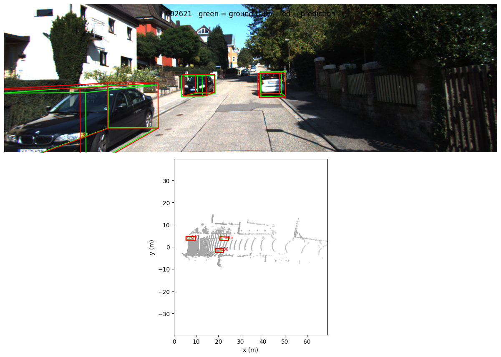
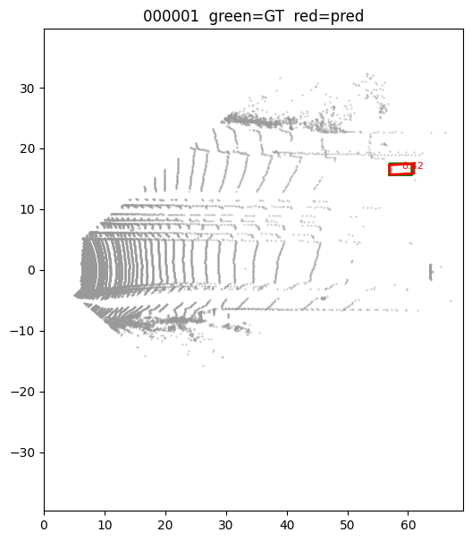
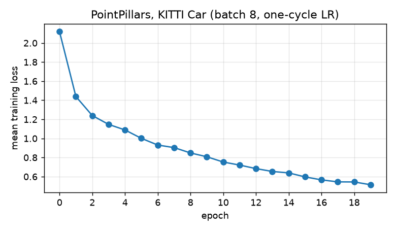
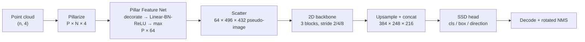

# PointPillars in pure PyTorch

A from-scratch reimplementation of **[PointPillars: Fast Encoders for Object Detection from Point Clouds](https://arxiv.org/abs/1812.05784)** (Lang et al., CVPR 2019) for 3D car detection on KITTI.

- **Pure PyTorch.** No spconv, no custom CUDA ops, no mmdet3d or OpenPCDet. It installs with `pip` on a fresh Colab runtime.
- **Small and readable.** The whole detector is about 800 lines, split into one module per stage of the paper.
- **Tested.** Unit tests cover pillarization, the box coder, heading recovery, KITTI coordinate round-trips, and a full forward/backward pass on synthetic data.

<p align="center">
  
</p>
<p align="center">
  
  
</p>

## How it works



| Stage | Paper | Code |
|---|---|---|
| Pillar grid: 0.16 m cells, at most P = 12000 pillars and N = 32 points per pillar | §2.1 | [`ops/pillarize.py`](pointpillars/ops/pillarize.py) |
| Point decoration to D = 9 (x, y, z, r, x<sub>c</sub>, y<sub>c</sub>, z<sub>c</sub>, x<sub>p</sub>, y<sub>p</sub>) + simplified PointNet | §2.1 | [`models/pfn.py`](pointpillars/models/pfn.py) |
| Scatter of pillar features back to a BEV pseudo-image | §2.1 | [`models/pfn.py`](pointpillars/models/pfn.py) |
| Top-down blocks + upsampling, concatenated | §2.2 | [`models/backbone.py`](pointpillars/models/backbone.py) |
| SSD head with 2 anchors per location (0°, 90°) | §2.3 | [`models/head.py`](pointpillars/models/head.py), [`anchors.py`](pointpillars/anchors.py) |
| Box encoding (Eq. 1), focal loss, sine-difference heading, direction classifier | §2.3 | [`ops/box_utils.py`](pointpillars/ops/box_utils.py), [`loss.py`](pointpillars/loss.py) |
| Global flip / rotation / scaling augmentation | §3.3 | [`data/augment.py`](pointpillars/data/augment.py) |

### Differences from the paper

- **Optimizer:** AdamW with a one-cycle learning-rate schedule, 20 epochs (the OpenPCDet recipe). The paper uses Adam with exponential decay over 160 epochs.
- **No GT-database sampling.** The paper pastes ground-truth objects from other frames into each scene. This is the biggest missing accuracy gain (see the roadmap).
- **Anchor matching** uses the IoU of the axis-aligned hulls of the rotated boxes, which is cheap on ~100k anchors. NMS and evaluation use exact rotated IoU.
- **Car class only.**

## Results

Car, AP<sub>R40</sub>, all difficulties pooled, score threshold 0.3. The model was trained for 20 epochs at batch size 8, about 167 s per epoch on a Colab T4 (≈ 56 min in total).

| Evaluation set | BEV AP@0.7 | BEV AP@0.5 | 3D AP@0.7 | 3D AP@0.5 |
|---|---|---|---|---|
| Full `val` split (3,769 frames) | **72.13** | **80.78** | – | – |
| 39-frame `val` subset* | 74.02 | 83.24 | 53.64 | 83.08 |

\* A later evaluation run had only part of the velodyne folder available, so just 39 val frames (187 detections) were scored. It's the only 3D measurement so far. Treat it as indicative: BEV AP on the subset is within 2 points of the full-split number. 3D AP for the full split is still to be measured.

Mean training loss fell from 2.12 after the first epoch to 0.52 after the last (plot above).

For reference, the paper reports Car moderate **86.10 BEV / 74.99 3D AP** on the KITTI *test* set, at 62 Hz. The two numbers aren't directly comparable:
- This run pools easy, moderate and hard cars, including heavily occluded and distant ones.
- It trains for 20 epochs instead of 160.
- It skips GT-database sampling.

> These numbers come from the original notebook version of the code. That version had the heading-flip bug described below. A box flipped by 180° has the same footprint and volume, so neither BEV nor 3D AP is affected; only the heading direction is. Run [`notebooks/evaluate.ipynb`](notebooks/evaluate.ipynb) to get full-split 3D AP, orientation similarity, distance breakdown, official easy/moderate/hard numbers and latency.

> `tools/evaluate.py` reports a simplified metric: one class over the whole split, with no easy/moderate/hard buckets and no DontCare handling. The numbers will be close to the official ones but not identical. For official numbers, export with `--export` and run the KITTI devkit or OpenPCDet's `kitti_object_eval_python`.

## Quick start

The easiest path is the [Colab notebook](notebooks/colab_demo.ipynb). Locally:

```bash
git clone https://github.com/<your-username>/pointpillars.git
cd pointpillars
pip install -e ".[dev]"
pytest                                   # ~1 min on CPU, no dataset needed
```

### Data

```bash
bash scripts/download_kitti.sh /path/to/kitti     # ~29 GB download
```

This produces:

```
kitti/
├── ImageSets/{train,val}.txt
└── training/{velodyne,calib,label_2}/
```

Point the config at it with `--set root=/path/to/kitti` (the default is `/content/kitti` for Colab).

### Train

```bash
python tools/train.py --cfg configs/car.yaml --out outputs/car
python tools/train.py --cfg configs/car.yaml --out outputs/car --resume outputs/car/last.pth
python tools/train.py --limit 64 --set train.epochs=1 train.eval_every=1    # smoke test
```

Training writes `last.pth` (full checkpoint for resuming), `best_model.pth` / `final_model.pth` (weights only), `config.yaml`, and `log.jsonl` (per-iteration losses and validation metrics). It takes about 2.8 minutes per epoch on a Colab T4 at batch size 8 (464 iterations).

### Evaluate and visualize

```bash
python tools/evaluate.py  --ckpt outputs/car/best_model.pth --export outputs/car/val_preds
python tools/visualize.py --ckpt outputs/car/best_model.pth --num 6 --out assets
```

Pretrained weights: _link to the GitHub Release asset_.

## Repository layout

```
configs/car.yaml            all hyperparameters
pointpillars/
  data/kitti.py             calibration, labels, camera ↔ LiDAR, dataset, KITTI export
  data/augment.py
  ops/pillarize.py          point cloud → pillars
  ops/box_utils.py          box coder, heading direction, IoU, NMS
  models/                   PFN + scatter, backbone, head, full model
  anchors.py                anchor grid + target assignment
  loss.py, postprocess.py, eval.py
tools/                      train / evaluate / visualize CLIs
tests/                      pytest suite on synthetic KITTI-shaped data
notebooks/colab_demo.ipynb
```

## Notes from the original notebook version

This started as a single Colab notebook. Refactoring it into this package fixed several issues:

- **Heading flip:** decoding used a different direction-bin offset than training, so about half of the predicted headings were rotated by 180°. BEV IoU can't see this because a flipped box has the same footprint, but 3D orientation and AOS-style metrics can. `tests/test_box_utils.py::test_direction_roundtrip_resolves_flip` now covers it.
- **Out-of-range ground truth:** cars beyond the 69 m detection range were counted as ground truth during evaluation, which lowered recall.
- **Non-deterministic evaluation:** frames with more than 12k pillars were subsampled randomly at evaluation time. Subsampling is now seeded per frame.

## Roadmap

- [ ] GT-database sampling augmentation (worth roughly 5–8 AP)
- [ ] Rotated IoU for anchor matching
- [ ] Pedestrian and Cyclist classes (more anchor sizes, wider head)
- [ ] Official KITTI evaluation numbers (easy / moderate / hard)
- [ ] ONNX / TensorRT export and latency benchmark

## Citation

```bibtex
@inproceedings{lang2019pointpillars,
  title     = {PointPillars: Fast Encoders for Object Detection from Point Clouds},
  author    = {Lang, Alex H. and Vora, Sourabh and Caesar, Holger and Zhou, Lubing and Yang, Jiong and Beijbom, Oscar},
  booktitle = {CVPR},
  year      = {2019}
}
```

## Acknowledgements

Conventions such as the LiDAR box format, the direction-bin offset and the KITTI train/val split follow [OpenPCDet](https://github.com/open-mmlab/OpenPCDet). KITTI data © Geiger et al., used under CC BY-NC-SA 3.0.
